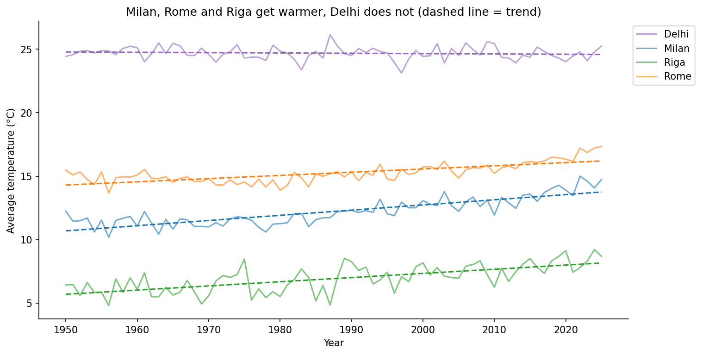
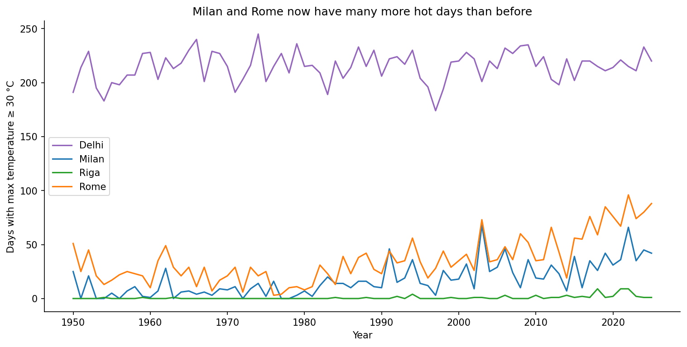

# Weather Report: Is Milan getting hotter?

This is my project for the Python module of the course Coding for Data Science and Data Management (University of Milan, 2026/27).

I wanted to check if the climate in Milan is really getting warmer, and how Milan compares to other cities. I chose Rome because it is another big Italian city, Riga because I studied there, and Delhi because I am from India. I use daily weather data from 1950 to 2025.

## Questions I want to answer

1. Is the average temperature going up, and how fast?
2. How much warmer are the last years compared to the period 1961 to 1990?
3. Are there more hot days now (days with a max temperature of 30 °C or more)?
4. Is the change the same in every city and in every month?

## Data

The data comes from the Open-Meteo Historical Weather API:
https://open-meteo.com/en/docs/historical-weather-api

It is free and you do not need an API key. For every day I download:

- the mean temperature
- the max temperature
- the total rain

The data is not saved in this repository. The script `src/fetch.py` downloads it into the `data` folder. The app also does this by itself the first time you run it.

## Files

```
weather-report/
    app.py              the Streamlit app
    requirements.txt    the libraries I use
    figures/            the charts
    data/               the downloaded CSV files (not on GitHub)
    src/
        fetch.py        downloads the data from the API
        process.py      loads and cleans the data, makes yearly and monthly tables
        analysis.py     calculates the anomaly and the warming trend
        plots.py        makes the charts
```

## How to install

You need Python 3.10 or newer.

```bash
git clone https://github.com/Dhingraakshat/weather-report.git
cd weather-report
python -m venv .venv
.venv\Scripts\activate
pip install -r requirements.txt
```

On Mac or Linux, use `source .venv/bin/activate` instead of the third line.

## How to run

To open the app:

```bash
python -m streamlit run app.py
```

You can also run each part alone:

```bash
python -m src.fetch       # download the data
python -m src.analysis    # print the results table
python -m src.plots       # save the charts in the figures folder
```

## What I did

- I grouped the daily data by city and year. For each year I took the average temperature, the total rain and the number of hot days.
- For the anomaly, I took the average temperature of 1961 to 1990 for each city. Then for every year I calculated how much warmer or colder it was than this average. 1961 to 1990 is a normal reference period in climate studies.
- For the trend, I used `numpy.polyfit` to fit a straight line through the yearly temperatures. I show the result in °C per 10 years, because per year the numbers are very small.
- I also compared the average of the first 30 years (1950 to 1979) with the last 30 years (1996 to 2025).
- In the heatmap, I compare every month with the normal value for that month. Without this, the chart only shows that summer is hot and winter is cold.

## Results

| City | Change per 10 years (°C) | First 30 years (°C) | Last 30 years (°C) | Difference (°C) | Hot days, change per 10 years |
|---|---|---|---|---|---|
| Milan | +0.41 | 11.32 | 13.25 | +1.93 | +4.6 |
| Rome | +0.25 | 14.74 | 15.92 | +1.18 | +6.7 |
| Riga | +0.33 | 6.20 | 7.68 | +1.49 | +0.4 |
| Delhi | -0.03 | 24.75 | 24.59 | -0.16 | +1.0 |

What I found:

- Milan gets warmer faster than the other cities. Since 1950 it is about 3 °C warmer. Almost every year after 1990 was warmer than the 1961 to 1990 average.
- The warming happens in all months, also in winter, not only in summer.
- Rome gets warmer more slowly than Milan, but it gets more new hot days. I think this is because summers in Rome were already close to 30 °C, so a small change makes many more days go over 30 °C.
- Riga gets warmer too, but it still has almost no hot days, because it is rarely that hot there.
- Delhi does not show a warming trend in this data. I was surprised by this. Some studies say that air pollution and more irrigation in north India can make temperatures lower, but I did not test this in my project.






## Limits of this project

- The data is not from one weather station in each city. It comes from a weather model that mixes real measurements and calculations.
- I use 30 °C as a hot day for all cities, but a hot day in Riga is not the same as a hot day in Delhi.
- A straight line is a simple way to show the trend. In reality, the warming is faster in the last years than at the start.

## Problems I had

- At first, only Milan and Rome downloaded. The API stopped me because I sent too many requests too fast. I added a pause of 5 seconds between cities, and after that all four cities worked.

## Use of AI

I used AI tools to help me plan the project, explain things I did not know, and check my code. I tested all the code myself and I can explain every part of it.

## License

MIT