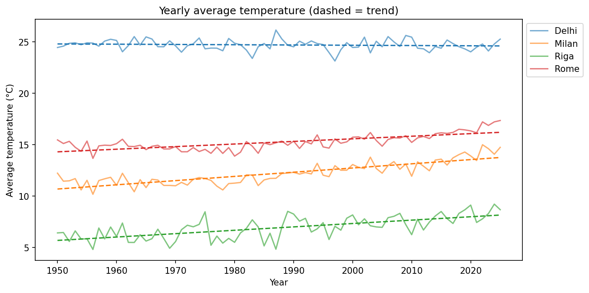
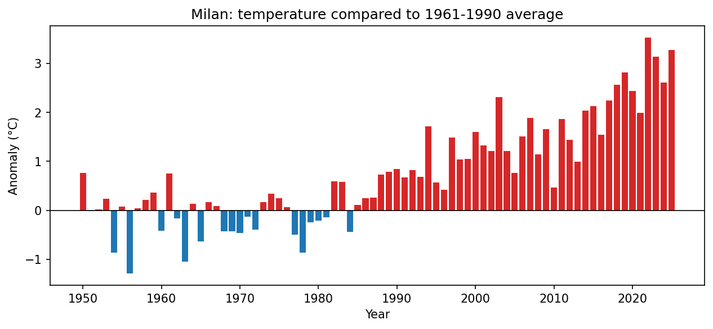
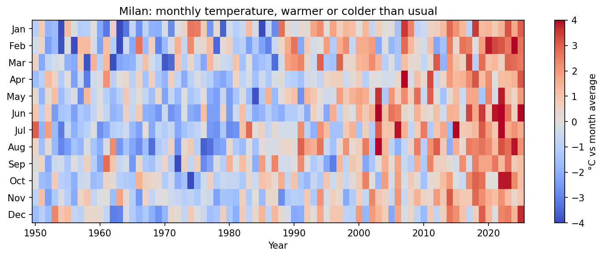
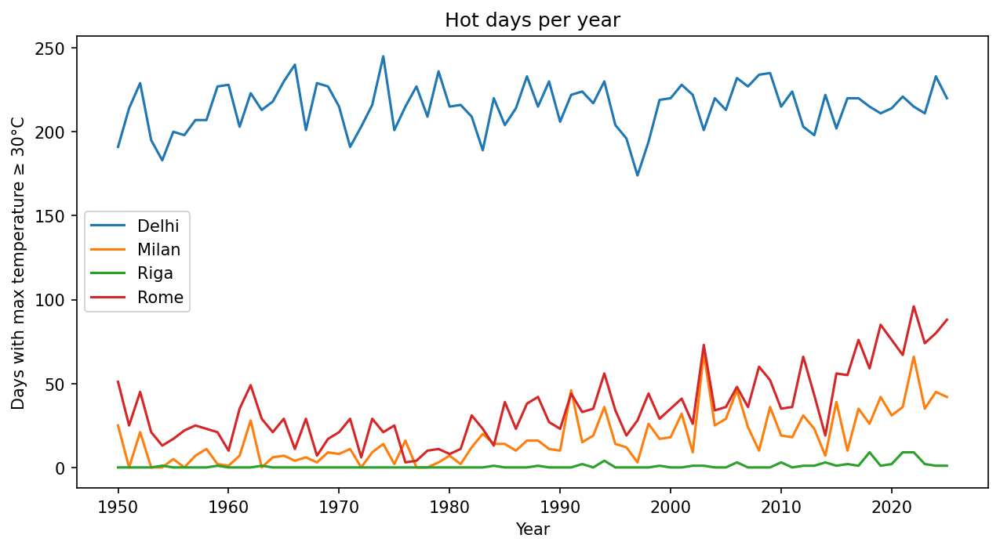

# weather-report
Analysis of long-term climate trends in Milan and other cities using Open-Meteo data
# 🌡️ Weather Report: Is Milan getting hotter?

Analysis of long-term climate trends in Milan, compared with Rome, Riga and Delhi, using daily historical weather data from 1950 to 2025.

Project for the Python module of *Coding for Data Science and Data Management* (Università degli Studi di Milano, A.Y. 2026/27).

## Research questions

- Has the average temperature increased since 1950, and how fast?
- How much warmer are recent years compared to the 1961–1990 "normal"?
- Are hot days (maximum temperature ≥ 30 °C) becoming more frequent?
- Is the warming the same in every city and in every month?

## Data

- **Source:** [Open-Meteo Historical Weather API](https://open-meteo.com/en/docs/historical-weather-api) (free, no API key needed)
- **Variables (daily):** mean temperature, maximum temperature, total precipitation
- **Period:** 1950-01-01 to 2025-12-31
- **Cities:** Milan, Rome, Riga, Delhi

The data is **not stored in the repository**. It is downloaded automatically into `data/` by `src/fetch.py`, or by the app on its first run.

## Project structure

```
weather-report/
├── app.py              # Streamlit app (presentation)
├── requirements.txt    # Python libraries and versions
├── figures/            # charts generated by src/plots.py
├── data/               # downloaded CSV files (ignored by git)
└── src/
    ├── fetch.py        # downloads the data from the Open-Meteo API
    ├── process.py      # loads, cleans and summarises the data (pandas)
    ├── analysis.py     # anomalies and warming trends (numpy)
    └── plots.py        # charts (matplotlib)
```

## Setup

Requires Python 3.10 or newer.

```bash
git clone https://github.com/Dhingraakshat/weather-report.git
cd weather-report
python -m venv .venv
.venv\Scripts\activate          # on macOS/Linux: source .venv/bin/activate
pip install -r requirements.txt
```

## How to run

Start the interactive app (downloads the data automatically if missing):

```bash
python -m streamlit run app.py
```

Or run each step separately:

```bash
python -m src.fetch       # download the data
python -m src.analysis    # print the summary table
python -m src.plots       # save the charts in figures/
```

## Methods

- **Yearly summaries:** daily data grouped by city and year (mean temperature, total rain, number of hot days).
- **Anomaly:** each year's mean temperature minus the city's 1961–1990 average (standard climate reference period).
- **Warming trend:** best-fit straight line (`numpy.polyfit`), reported in °C per decade.
- **Old vs recent:** average of the first 30 years (1950–1979) compared to the last 30 years (1996–2025).
- **Monthly heatmap:** each month compared to that month's long-term average, to remove the seasonal cycle.

## Main results

| City | Warming (°C/decade) | First 30 years (°C) | Last 30 years (°C) | Difference (°C) | Hot days change (per decade) |
|---|---|---|---|---|---|
| Milan | +0.41 | 11.32 | 13.25 | +1.93 | +4.6 |
| Rome | +0.25 | 14.74 | 15.92 | +1.18 | +6.7 |
| Riga | +0.33 | 6.20 | 7.68 | +1.49 | +0.4 |
| Delhi | −0.03 | 24.75 | 24.59 | −0.16 | +1.0 |

- **Milan has warmed clearly:** almost every year since the late 1980s is above the 1961–1990 normal, with recent years around +3 °C.
- **The warming happens in every season**, not only in summer (see heatmap).
- **Hot days increased a lot** in Milan and Rome, while Riga still has almost none.
- **Delhi shows no warming trend** in this dataset. Possible explanations discussed in the literature include air pollution and expanded irrigation in northern India, but this project does not test them.






## Limitations

- Open-Meteo historical data comes from reanalysis models (a reconstruction combining observations and weather models), not from a single weather station in each city.
- The 30 °C hot-day threshold is the same for all cities, even though "hot" means something different in Riga and in Delhi.
- A straight-line trend is a simplification; warming has accelerated in recent decades.

## License

MIT