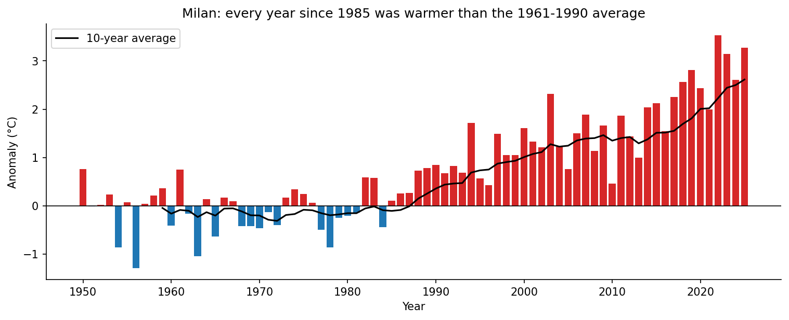
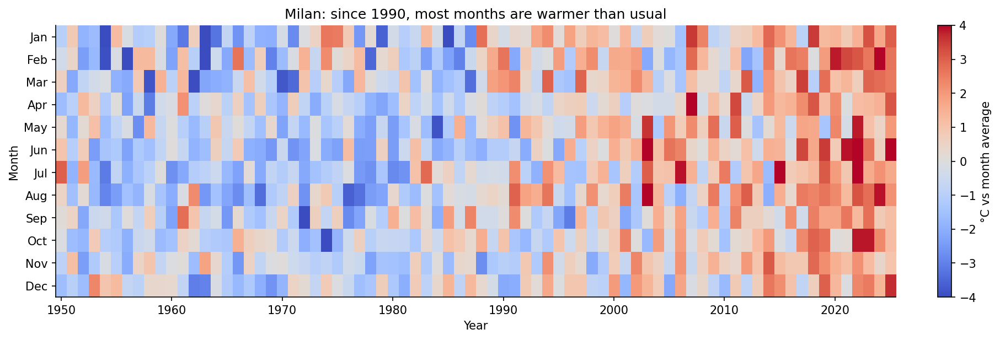
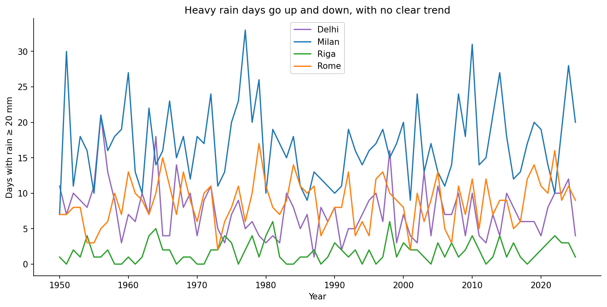

# Weather Report: Is Milan getting hotter?

This is my project for the Python module of the course Coding for Data Science and Data Management (University of Milan, 2026/27).

I wanted to check if the climate in Milan is really getting warmer, and how Milan compares to other cities. I chose Rome because it is another big Italian city, Riga because I studied there, and Delhi because I am from India. I use daily weather data from 1950 to 2025.

## Questions I want to answer

1. Is the average temperature going up, and how fast?
2. How much warmer are the last years compared to the period 1961 to 1990?
3. Are there more hot days now (days with a max temperature of 30 °C or more)?
4. Is the change the same in every city and in every month?
5. Has heavy rain become more frequent (days with 20 mm of rain or more)?

## Data

The data comes from the Open-Meteo Historical Weather API:
https://open-meteo.com/en/docs/historical-weather-api

It is free and you do not need an API key. For every day I download:

- the mean temperature
- the max temperature
- the total rain

The data is not saved in this repository. The script `weather_report/fetch.py` downloads it into the `data` folder. The app also does this by itself the first time you run it.

## Libraries

- `requests` downloads the data from the API
- `pandas` loads the data and makes the yearly and monthly tables
- `numpy` fits the straight trend line
- `scipy` calculates the p-value of the trend
- `matplotlib` makes the charts
- `streamlit` runs the app
- `pytest` runs the tests

The exact versions are in `requirements.txt`.

I also used Ruff (version 0.17.5) to check the code and to format it in the PEP 8 style. Ruff is not in `requirements.txt`, because my code does not import it. It is only a tool for writing the code. If you want to use it:

```bash
pip install ruff
ruff check .
ruff format .
```

## Files

```
weather-report/
    app.py              the Streamlit app
    requirements.txt    the libraries I use
    ruff.toml           the settings for Ruff (79 characters per line)
    LICENSE             the MIT license
    figures/            the charts
    data/               the downloaded CSV files (not on GitHub)
    notebooks/          exploration.ipynb, my first look at the data
                        and an example of how to use the package
    tests/              the tests (test_project.py)
    weather_report/     the Python package with my code
        __init__.py     makes the folder a package
        fetch.py        downloads the data from the API
        process.py      loads and cleans the data, makes yearly and monthly tables
        analysis.py     calculates the anomaly, the trends and the p-values
        plots.py        makes the charts
```

## How to install

You need Python 3.11 or newer.

```bash
git clone https://github.com/Dhingraakshat/weather-report.git
cd weather-report
python -m venv .venv
.venv\Scripts\activate
pip install -r requirements.txt
```

On Mac or Linux, use `source .venv/bin/activate` instead of the fourth line.

## How to run

To open the app:

```bash
python -m streamlit run app.py
```

In the app you can choose the cities, the years and the length of the moving average. You can also download the results table as a CSV file.

You can also run each part alone:

```bash
python -m weather_report.fetch       # download the data
python -m weather_report.analysis    # print the results table
python -m weather_report.plots       # save the charts in the figures folder
```

The notebook `notebooks/exploration.ipynb` shows my first look at the data. At the end, it shows how to use the functions of the `weather_report` package. You can open it in Jupyter or in VS Code.

## Tests

I wrote some small tests with pytest. They check the trend, the anomaly, the hot day count, the heavy rain day count and the error when the data is missing. To run them:

```bash
python -m pytest
```

## What I did

- I grouped the daily data by city and year. For each year I took the average temperature, the total rain, the number of hot days and the number of heavy rain days.
- For the anomaly, I took the average temperature of 1961 to 1990 for each city. Then for every year I calculated how much warmer or colder it was than this average. 1961 to 1990 is a normal reference period in climate studies.
- For the trend, I used `numpy.polyfit` to fit a straight line through the yearly temperatures. I show the result in °C per 10 years, because per year the numbers are very small.
- To check if the trend is real or just random, I used `scipy.stats.linregress`. It gives a p-value. If the p-value is smaller than 0.05, I say the trend is significant.
- I also compared the average of the first 30 years (1950 to 1979) with the last 30 years (1996 to 2025).
- In the heatmap, I compare every month with the normal value for that month. Without this, the chart only shows that summer is hot and winter is cold.
- I also calculated the trend for each season (winter, spring, summer, autumn), to see if some parts of the year get warmer faster than others.
- For rain, I calculated the trend of the total rain per year (with its p-value) and the trend of the number of heavy rain days. In the notebook I tried 10, 20 and 50 mm for a heavy rain day. 10 mm is too common and 50 mm is too rare, so I chose 20 mm (about 17 days a year in Milan).

## Results

| City | Change per 10 years (°C) | p-value | Significant | First 30 years (°C) | Last 30 years (°C) | Difference (°C) | Hot days, change per 10 years |
|---|---|---|---|---|---|---|---|
| Milan | +0.41 | < 0.0001 | Yes | 11.32 | 13.25 | +1.93 | +4.6 |
| Rome | +0.25 | < 0.0001 | Yes | 14.74 | 15.92 | +1.18 | +6.7 |
| Riga | +0.33 | < 0.0001 | Yes | 6.20 | 7.68 | +1.49 | +0.4 |
| Delhi | -0.03 | 0.34 | No | 24.75 | 24.59 | -0.16 | +1.0 |


Warming by season (°C per 10 years):

| City | Winter | Spring | Summer | Autumn |
|---|---|---|---|---|
| Milan | +0.43 | +0.36 | +0.53 | +0.31 |
| Rome | +0.15 | +0.23 | +0.40 | +0.23 |
| Riga | +0.47 | +0.42 | +0.23 | +0.19 |
| Delhi | -0.03 | -0.11 | -0.09 | +0.13 |

Rain:

| City | Total rain, change per 10 years (mm) | p-value | Significant | Heavy rain days, change per 10 years |
|---|---|---|---|---|
| Milan | -1.3 | 0.92 | No | +0.1 |
| Rome | -6.6 | 0.45 | No | +0.2 |
| Riga | +3.5 | 0.50 | No | +0.1 |
| Delhi | -16.5 | 0.10 | No | -0.3 |

What I found:

- Milan gets warmer faster than the other cities. The trend line goes up about 3 °C from 1950 to 2025 (0.41 °C per 10 years for 7.5 decades). The last 30 years are 1.93 °C warmer than the first 30 years. Every year after 1990 was warmer than the 1961 to 1990 average.
- The warming happens in all months, also in winter, not only in summer.
- Rome gets warmer more slowly than Milan, but it gets more new hot days. I think this is because summers in Rome were already close to 30 °C, so a small change makes many more days go over 30 °C.
- Riga gets warmer too, but it still has almost no hot days, because it is rarely that hot there.
- Delhi does not show a warming trend in this data. The p-value is 0.34, so the small change could be just random. I was surprised by this. Some studies say that air pollution and more irrigation in north India can make temperatures lower, but I did not test this in my project.
- In Milan and Rome, summer gets warmer the fastest. In Riga it is the opposite: winter and spring get warmer faster than summer. This is also why Riga still has almost no hot days. For Delhi the values are small and go in both directions, so there is no clear change.
- Heavy rain has not become more frequent. In all four cities, the number of heavy rain days changes by less than 1 day per 10 years. The total rain has no significant trend either, because all p-values are bigger than 0.05. So in this data the temperature changes clearly, but the rain does not.







## Limits of this project

- The data is not from one weather station in each city. It comes from a weather model that mixes real measurements and calculations.
- I use 30 °C as a hot day for all cities, but a hot day in Riga is not the same as a hot day in Delhi. In the same way, I use 20 mm as a heavy rain day for all cities.
- Rain changes a lot from one year to the next. With 76 years of data, a small change in rain is hard to find, so "no significant trend" does not prove that nothing changed.
- A straight line is a simple way to show the trend. In reality, the warming is faster in the last years than at the start.
- The p-value test thinks that every year is independent. But a warm year is often followed by another warm year, so the real p-values are probably a bit bigger. For Milan, Rome and Riga they are so small that this does not change the result.
- For seasons, I put December in the same year as January and February. Climate studies usually put it with the next year. This changes the results only very little.

## Problems I had

- At first, only Milan and Rome downloaded. The API stopped me because I sent too many requests too fast. First I added a pause of 5 seconds between cities, but this was not enough on a new computer: the download still stopped after two cities. The API has a limit per minute, so now the pause is 60 seconds. The first download takes about 4 minutes, but all four cities work in one run. If the download still stops, wait one minute and run it again. Cities that are already downloaded are skipped.

## License

MIT
